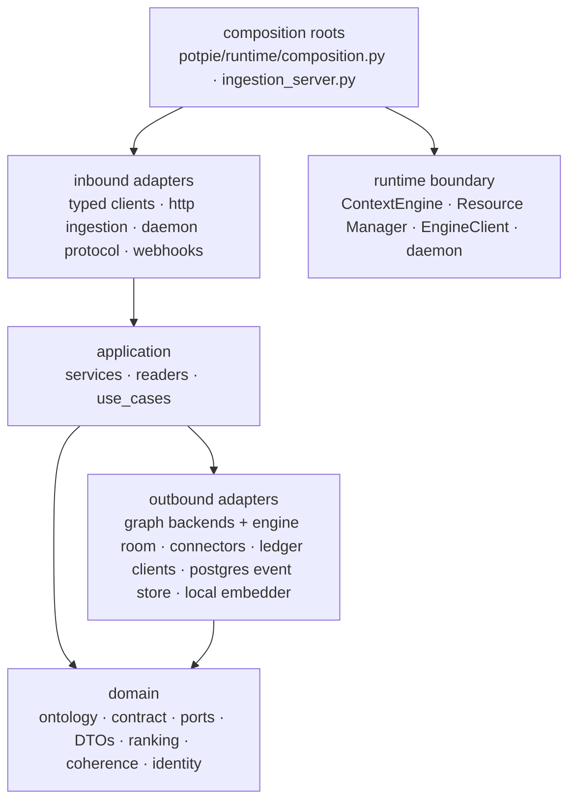
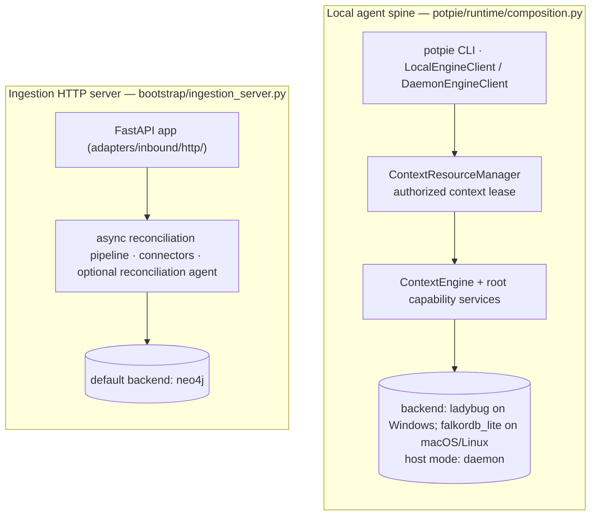
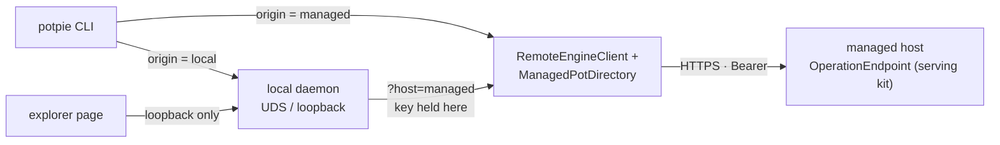
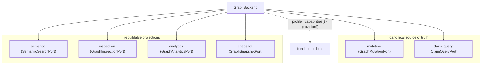
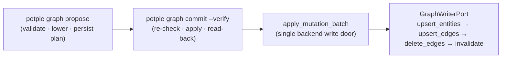
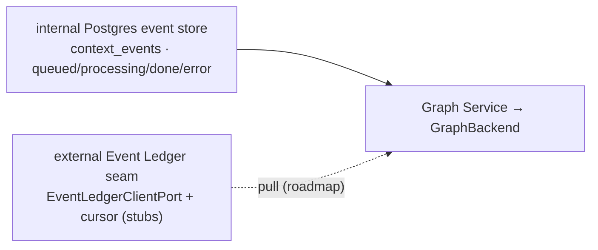

## Overview

> Status: reflects the canonical Context Runtime boundary, last reviewed 2026-08-24.

This is the implementation map for the Context Graph: the layered code, the
composition roots that wire it, the daemon that hosts it, the swappable
`GraphBackend`, and the shared storage engine room underneath. It orients you to
the moving parts and points at the docs that own each flow in full — the read
path lives in [querying.md](./querying.md), the write path in
[writing.md](./writing.md), the vocabulary in [ontology.md](./ontology.md), and
ingestion/nudge in [ingestion-nudge.md](./ingestion-nudge.md).

The single most important framing fact: the `potpie graph …` workbench is
**shipped today** as the V1.5 surface. The string `v2` survives only as the
workbench *envelope* version (`GRAPH_WORKBENCH_CONTRACT_VERSION="v2"`); the data
plane is `GRAPH_CONTRACT_VERSION="v1.5"` / `ONTOLOGY_VERSION="2026-06-graph"`.
Both the legacy `resolve`/`search`/`record` wrappers and the full workbench ship
now. The **canonical write door is `graph propose` → `graph commit --verify`**;
`graph mutate` is a legacy wrapper over it (see [Writing the graph, high
level](#the-write-door-high-level)).

## Hexagonal layers

The engine is ports-and-adapters. Pure model in the middle, I/O at the edges,
composition roots at the top.



| Layer | Path | Responsibility |
|---|---|---|
| **domain/** | `domain/` | Pure model and contracts: the three ontology catalogs, contract constants, ports (Protocols), DTOs, ranking, coherence invariants, identity. No I/O. Import-time coherence guards fail startup fast if vocabularies drift. |
| **application/** | `application/` | Services and use cases that orchestrate domain over ports: `services/` (graph_service, graph_workbench, agent_context, read_orchestrator, envelope_builder, nudge_service, skill_manager, semantic_mutation_validator/lowering, reconciliation_validation, ingestion_submission_service), `readers/` (the 10 readers), `use_cases/` (the ingestion pipeline). |
| **adapters/** | `adapters/inbound`, `adapters/outbound` | Concrete I/O. Inbound: HTTP ingestion server and webhooks. Outbound: graph backends + the shared engine room, connectors, ledger clients, the Postgres event store, `intelligence/local_embedder`, the session injection ledger. Root CLI, daemon, and capability adapters live under `potpie/`. |
| **bootstrap/** | `bootstrap/` | Context Engine standalone HTTP composition. The local product composition lives under `potpie/runtime/`. |
| **runtime + daemon** | `potpie/runtime/`; `potpie/daemon/` | Context-bound clients, authorization/resource management, typed daemon protocol, and root capability lifecycle. |

The local spine is `CLI → EngineClient → ContextResourceManager → ContextEngine`
for engine-owned operations. Root capability commands use finite root-owned
services. Agents reach both through the CLI.

## Two composition roots / two HTTP roots

There are **two separate composition roots**, and conflating them is the most
common architecture error.



1. **The local agent spine** — `potpie/runtime/composition.py
   build_local_runtime()` composes separate root capability and engine service
   groups. Engine-owned CLI operations use `LocalEngineClient` in-process or
   `DaemonEngineClient` over the versioned authenticated daemon protocol. The
   daemon listens privately over UDS with loopback TCP fallback. Root capability
   commands use finite root-owned services. **Default backend:
   `ladybug` on Windows, `falkordb_lite` on macOS/Linux. Default host mode: `daemon`.**
2. **The ingestion HTTP server** — `bootstrap/ingestion_server.py
   IngestionServerContainer` composes the FastAPI app under
   `adapters/inbound/http/` (the async reconciliation pipeline, connectors, the
   optional reconciliation agent). That public FastAPI app is the **second HTTP
   root**. **Default backend here: `neo4j`** (via `settings.graph_db_backend()`).
   It is a distinct Context Engine delivery root.

Both roots run the same domain/application code over a swappable `GraphBackend`;
they differ only in wiring and default storage.

A third deployment serves the same typed operations remotely: a **managed
host** (next section). The `cloud` command group is still roadmap and raises
`CapabilityNotImplemented`.

## Managed hosts: one protocol, two deployments

A managed host is a hosted service that embeds the same engine and serves the
same typed envelope as the local daemon, at `POST <base>/v1/operations` over
HTTPS with `Authorization: Bearer <per-actor key>`. There is no second wire
format and no other remote route.



**Client side** (root `potpie`):

- `potpie.config.host_registry` — the origins, `<home>/cli_hosts.json`, the URL
  and TLS rules, and which origin an invocation targets. It lives under
  `config` because the daemon's explorer reads it too.
- `potpie.runtime.remote` — `RemoteEngineClient` (the engine catalog for one
  selector), `RemoteHostClient` (`host.*` and extension operations),
  `ManagedPotDirectory`, and `connect()` → `HostConnection` with one pooled
  keep-alive HTTPS client per host and event loop.
- `potpie.pots.directory.PotDirectory` — the pot control plane of one host:
  `LocalPotDirectory` over the in-process pot service, `ManagedPotDirectory`
  over `host.*`. CLI pot, source, grant, `whoami` and `status` commands use it.
- `potpie.daemon.http.ui.source.ExplorerSource` — the explorer reads either the
  daemon's own services (local) or the remote clients (managed); the whole
  graph is the `graph_slice` operation in both.

**No lock-step.** The local daemon keeps its catalog fingerprint and per-boot
tickets. A managed host issues no tickets and keeps no per-boot state: each
request is checked on its own. Requests leave default-valued fields off the
wire, a host refuses an operation or field it does not know by name, the client
reports that as `host_outdated`, and results decode leniently. A newer client
keeps working against an older host for every call that does not need the new
thing.

**Identity and selection.** The host authenticates the bearer before it
decodes or selects anything, then resolves the pot selector for that actor
(explicit, active, or repository, using only the pots the actor holds a grant
on) and authorizes the operation for the actor's role. `host.*` operations
(pots, sources, repo defaults, grants, `whoami`) are root-Potpie product
operations the local daemon does not serve; `ext.<vendor>.*` names are
registered by the embedding host.

**Server side.** `potpie.runtime.hosting` is the serving kit an embedding host
builds on: `OperationEndpoint`, the actor-aware `ContextResourceManager`,
`CatalogSelectorResolver`, the host-operation handler protocol, extensions and
scoped commit access. `potpie.runtime.hosting_testing` holds the client half a
host's contract tests need. Both surfaces are provisional: names may still move
while the managed-host contract settles.

## The daemon model

`potpie/daemon/lifecycle.py Daemon` is the local background-process lifecycle
service; `potpie/runtime/controller.py` owns direct subprocess observation and
the typed protocol provides IPC. The daemon is explicitly **not** the business
layer. Two modes:

- **in_process** — `LocalEngineClient` invokes the same typed operation handlers
  and Resource Manager in the CLI process.
- **daemon** — a separate `python -m potpie.daemon` process serves the typed,
  authenticated protocol over UDS or loopback TCP. The CLI uses
  `DaemonEngineClient` after a successful handshake.

The handshake compares the recursive operation and wire-schema catalog and
returns a unique, opaque, boot-scoped compatibility ticket. The daemon derives
the ticket from its per-boot secret and requires it on every later non-handshake
request. The ticket proves that one client negotiated this protocol catalog; it
is not caller identity or authorization. Bearer authentication is checked
separately and remains the current transitional daemon-auth mechanism, not the
final identity model for local IPC, Potpie login, hosted clients, integrations,
or browser access.

Context-free typed metadata such as `graph describe` still crosses the
authenticated daemon boundary but bypasses context selection and engine
leasing. Destructive graph reset takes the opposite path: the CLI binds
confirmation to one resolved context and the selected runtime's Context Engine
executes the reset against its own backend. Pot metadata services never reset a
graph or compose a second backend.

Mode is chosen by `CONTEXT_ENGINE_HOST_MODE` (`daemon` | `in_process`);
`default_host_mode()` returns **`daemon`**, so the shipped CLI default is a
background daemon. `get_engine_client()` (`commands/_common.py`) selects the
daemon client by default and the local client when
`CONTEXT_ENGINE_HOST_MODE=in_process`.

**Liveness ≠ readiness.** The daemon can be live while a backend or semantic
index is not yet ready; the two are reported separately. `potpie doctor`
composes `backend.capabilities()` + `backend.mutation.readiness()` +
`daemon.status()` + `ledger.status()` so a half-ready system is debuggable.
`potpie ui` (the read-only graph explorer) is served by this daemon — it ensures
the daemon, discovers `base_url`, and opens `<base>/ui?[pot=<id>&]k=<code>`.
`/ui/api` takes the daemon's bearer token or a session cookie; `k` is a
single-use code the CLI mints with that token, which the page trades for an
HttpOnly session cookie, so the token itself never reaches the browser.

## CLI surfaces onto one data plane

Reads and writes both reach `DefaultGraphService`
(`application/services/graph_service.py`) over the backend, but the CLI exposes
two shapes:

- **Compatibility commands** — `potpie resolve` / `search` / `record` /
  `status`, bound by `AgentContextService`.
- **Graph Surface Lite (V1.5)** — the richer `potpie graph …` workbench
  (`catalog`/`read`/`search-entities`/`neighborhood`/`propose`/`commit`/`bulk`/
  `history`/`inbox`/`quality` …).

Both are shipped. The read shapes and the 9-reader trunk are owned by
[querying.md](./querying.md); the write stack is owned by
[writing.md](./writing.md). No read returns a server-synthesized answer —
reads return ranked evidence (`AgentEnvelope`) and the agent reasons over it.

## The `GraphBackend` port

`domain/ports/graph/backend.py` defines `GraphBackend` as a `@runtime_checkable`
Protocol that **bundles six capability ports** in two tiers, plus three bundle
members.



- **Canonical:** `mutation` (`apply`/`apply_async`, `invalidate`, `reset_pot`,
  `readiness`) and `claim_query` (`find_claims`, `entity_labels`,
  `entity_properties`). Note `ClaimQueryPort` lives at
  `domain/ports/claim_query.py`, **not** under `graph/`.
- **Projections (rebuildable):** `semantic` (vector NN over claim embeddings,
  stamps `semantic_similarity`), `inspection` (`neighborhood`/`path`/`labels`/
  `slice` → backs `graph neighborhood`/`inspect` + the explorer UI), `analytics`
  (`counts`/`freshness`/`quality`/`repair`), `snapshot` (`export`/`import_`).
- **Bundle members:** `profile` (string), `capabilities() -> BackendCapabilities`
  (a frozen dataclass declaring which of the six are *really* implemented vs
  fail-closed — read by `backend status`/`doctor`), and `provision() ->
  BackendProvisionResult` (`domain/ports/provisioning.py`; the setup seam where a
  backend stands up its own store idempotently).

Two workbench stores also live under `domain/ports/graph/` but are **not** part
of the six-cap bundle: `inbox_store.py` and `plan_store.py`.

The registry (`adapters/outbound/graph/backends/__init__.py`) is
`build_backend(profile, *, settings, embedder)`. `KNOWN_PROFILES = (in_memory,
embedded, ladybug, neo4j, falkordb, falkordb_lite, postgres, chroma, hosted)`. It
normalizes names (`falkordblite`→`falkordb_lite`, dashes→underscores) and, when
`embedder is None` for a real profile, default-builds the bundled local embedder
(disable via `CONTEXT_ENGINE_EMBEDDER=none`).

### Backend coverage — real capabilities per profile

This table is the corrected source of truth (the older doc overstated coverage).
A "real cap" is one whose port actually executes; everything else is fail-closed
and raises `CapabilityNotImplemented`.

| Profile | Backend class | Real caps | Notes |
|---|---|---:|---|
| `in_memory` | `InMemoryGraphBackend` | **6/6** | Conformance/reference; genuinely real (validates, MERGEs by identity, bitemporal invalidation, embeds on write); `dump_store`/`load_store`. |
| `embedded` | `EmbeddedGraphBackend` | **6/6** (delegated) | OSS JSON-persisted fallback wrapping `in_memory`; persists to `<home>/graph.json` after each mutation (atomic tmp-replace). |
| `ladybug` | `LadybugGraphBackend` | **6/6** (shared semantic adapters) | **The Windows OSS/CLI default.** Native Ladybug tables and atomic transactions with durable receipts, revisions, and journal. |
| `falkordb_lite` | `FalkorDBLiteGraphBackend` | **6/6** | **The macOS/Linux OSS/CLI default.** Embedded FalkorDBLite via `redislite` over a local file — no server, no Docker. |
| `falkordb` | `FalkorDBGraphBackend` | **6/6** | Full FalkorDB server over a redis URL; needs the optional `falkordb` client. |
| `neo4j` | `Neo4jGraphBackend` | **5/6** (no inspection) | "Shape-first production target"; native relationship vector index. |
| `postgres` / `chroma` / `hosted` | `StubGraphBackend` | **0/6** | Fail-closed seam: every port and `provision` raise `CapabilityNotImplemented("graph.<profile>.<cap>.<method>")`. Documented but unbuilt; `backend list` still shows them. |

**Cross-profile gaps to internalize:**

- Claim-key `mutation.invalidate` runs through the native atomic writer on
  Neo4j and FalkorDB; it raises `CapabilityNotImplemented` only for an injected
  legacy writer that has no atomic mutation surface.
- `snapshot` (export/import) is implemented on `in_memory`, `embedded`, `ladybug`,
  `falkordb_lite`, `falkordb`, and `neo4j`; FalkorDB and Neo4j apply an import
  atomically against the pot's revision (see `graph export`/`graph import` in
  [cli-flow.md](./cli-flow.md)).
- `inspection` is real on `in_memory`/`embedded`/`falkordb` but **not** Neo4j.
- Net effect: **FalkorDB is more complete than Neo4j** (6 vs 5 ports), and the
  macOS/Linux default `falkordb_lite` is a first-class backend, not a stub.

> **Roadmap (not yet wired):** `inspection` on neo4j; the
> `postgres`/`chroma`/`hosted` backends (all `StubGraphBackend`).

### Ladybug storage and scope

Ladybug stores entities, physical claim records, claim-to-entity relationships,
revisions, execution receipts, and journal entries in native tables. Each
operation holds the shared local process/file lock while opening the database,
reading state, and closing it. Writes commit the graph and its receipt together
before publishing the new state to readers. This lets the CLI and daemon use
the same database without competing long-lived native handles.

The backend reuses the current local mutation and read adapters for claim
history, filtering, snapshots, and exact vector ranking. It loads the whole
graph for operations and replaces native records in a transaction on mutation;
this first implementation is intended for local graphs, not large-scale native
query execution. It does not install the native HNSW extension or use an
isolated search subprocess. Embeddings come from the configured embedder.

The normal Windows install includes Ladybug. To opt in on macOS/Linux, install
`potpie-context-engine[ladybug]` and set `CONTEXT_ENGINE_BACKEND=ladybug`.
`CONTEXT_ENGINE_LADYBUG_PATH` (then `LADYBUG_PATH`) overrides the default
`<CONTEXT_ENGINE_HOME>/context_graph/ladybug.db`; the default home is `~/.potpie`.
Switching backend does not migrate an existing FalkorDB or experimental Ladybug
database. Use portable graph export/import to transfer supported graph data.

## The shared engine room

The real storage logic is shared across backends, not duplicated per profile
(`adapters/outbound/graph/`). This is the implementation underneath the canonical
ports.

| Module | Role |
|---|---|
| `cypher.py` | The **Position-B canonical write engine shared by BOTH the Neo4j and FalkorDB writers.** Claims are stored as `(:Entity {group_id, entity_key})-[:RELATES_TO {group_id, name, subject_key, object_key, source_ref, valid_at, invalid_at, created_at, …}]->(:Entity)`. The MERGE key **includes `source_ref`** so corroborating writes from different sources don't collide; bitemporal stamps (`valid_at`/`invalid_at` = event time, `created_at` = system time); `_supersede_singleton_predecessors` stamps `invalid_at` on prior disagreeing live singleton claims. A Phase-0 spike proved this Cypher runs unchanged on FalkorDB. |
| `canonical_claim_query.py` | Shared `FIND_CLAIMS_CYPHER`, `ENTITY_LABELS_CYPHER`, `row_from_record`, the lexical `embedding_score` token-overlap scorer, `stamp_similarity`/`stamp_scored_rows`, `CONTRACT_EDGE_KEYS`. Both readers reuse these; the FalkorDB reader only swaps row normalization. |
| `claim_query_analytics.py` / `claim_query_semantic.py` | Give any claim-backed profile a real analytics projection and a `fact_query`-routed semantic search computed on read. |
| `apply_plan.py` | `apply_mutation_batch` (alias `apply_reconciliation_plan`) — the **single async write door** (high-level below; full flow in [writing.md](./writing.md)). |
| `writer_port.py` | `GraphWriterPort` — the narrow async mutation surface (`ensure_indexes`, 4 verbs, `reset_pot`), implemented by `Neo4jGraphWriter` and `FalkorDBGraphWriter`. Storage-internal; services depend on `GraphBackend`/`GraphMutationPort`, not this. |
| `in_memory_reader.py` | `InMemoryClaimQueryStore` — full filter semantics; `match_mode` = `vector` (embedder cosine over `fact_embedding`) or `lexical` (token overlap). |
| `context_graph_service.py` | Legacy `ContextGraphPort` DTO shim; `apply_plan`/`apply_plan_async` are **disabled** (raise `CapabilityNotImplemented`) — writes must go through `GraphService.mutate`. |
| `plan_stores/local_json.py`, `inbox_stores/local_json.py` | JSON workbench stores (plans, inbox) under the Potpie home. |

`FalkorDBGraphProvider` memoizes **one** graph handle so the Falkor reader and
writer share a single embedded instance.

## The write door (high level)

The canonical write door is two-phase: **`graph propose` → `graph commit
--verify`** (Spine A, `application/services/graph_workbench.py`). `propose`
validates, lowers accepted ops, and persists a plan record with no graph write;
`commit` re-checks the conflict guard, enforces approval for medium/high risk,
calls the single backend write door, and `--verify` reads the committed claims
back.



Two corrections to the previous version of this doc:

- **`graph mutate` is a legacy wrapper, not the canonical door.** It internally
  calls `propose` then `commit` and emits a legacy warning
  (`commands/graph.py`). The direct-apply `DefaultGraphService.mutate` (Spine B)
  is now reached **only** through `record` / `context_record`, never via `graph
  mutate`.
- There **is** a server-created `plan_id` and a real `propose|commit` contract —
  the prior claim that none existed was wrong.

Optimistic concurrency on this path is per pot: a plan records the pot's
monotonic revision (`{"_global": <revision>}`) and commit compares it while
applying — there are no per-subgraph versions (writing.md §5.2 has the
per-backend guarantees). `GraphMutationDiff.to_dict()` emits `entity_upserts`, `edge_upserts`,
`edge_deletes`, `invalidations`, `claims_asserted`, `claims_retracted`,
`claim_keys`. The full tiered stack — semantic DSL (flat ops), validation/risk,
lowering, the 4-verb idempotent apply, inbox, and quality — is owned by
[writing.md](./writing.md).

## Persistence & per-pot scoping

Every fact is scoped by **`pot_id`, which IS the Cypher `group_id`** on every
`:Entity` node and `:RELATES_TO` edge. `reset_pot` is `MATCH (n {group_id:$gid})
DETACH DELETE n`. There is no cross-pot federation (an explicit anti-goal).

| Profile | Where it persists | Pot isolation |
|---|---|---|
| `in_memory` | Process-local, ephemeral | by `group_id` |
| `embedded` | One multi-pot `<home>/graph.json`, atomic rewrite per mutation | by `group_id` |
| `falkordb_lite` | `redislite` file at `falkordb_lite_path()` (default `.potpie/context_graph/falkordb.db`), single keyspace `context_graph` | by `group_id` |
| `ladybug` | native database at `ladybug_path()` (default `<home>/context_graph/ladybug.db`) | composite pot/entity and pot/claim storage identities |
| `neo4j` | External server, one DB | by `group_id` |

Relevant settings (`domain/ports/settings.py`): `graph_db_backend()='neo4j'`,
`falkordb_mode()='lite'`, `falkordb_graph_name()='context_graph'`,
`falkordb_lite_path()='.potpie/context_graph/falkordb.db'`, plus the Neo4j URI/
credentials.

## Resource store

The graph holds claims and pointers, never payloads. A document's content lives
in the **resource store** instead, split in two:

- **Bytes** become chunk files on disk, pot-scoped, behind `ResourceStorePort`
  (`core/ports/resource_store.py`) so another backend can replace local disk.
- **Structure** goes into the graph: a `Document` (`document:<slug>`) owns one
  `DocumentSection` (`docsection:<doc>:<section>`) per real division of the
  source through `SECTION_OF`, and each section's summary is a claim normal
  retrieval finds. Chunks are files, not nodes, so a 500-page PDF becomes tens
  of nodes, not hundreds.

Potpie does not parse documents. The agent writes an extraction script that
emits a chunk directory (`meta.json` plus `<section>/<seq>.txt`) and
`potpie resource import` absorbs it, so chunk text never passes through the
agent's output tokens. The `potpie-resource-*` skills teach that flow
([skills.md](./skills.md)); the commands are in [cli-flow.md](./cli-flow.md).

```text
evidence id   potpie://res/<doc>/<section>/<seq>@rev<N>   immutable; seq zero-padded to 4 digits
chunk file    <home>/resources/<pot_dir>/<doc>/<section>/<seq>.txt
prior revs    <home>/resources/<pot_dir>/<doc>/.versions/<N>/
pot_dir       <sanitized pot id>-<sha256(pot id)[:16]>     injective; never escapes the root
chunk size    target 4,000 chars, hard cap 8,000           rejected at import, never clamped at read
limits        import 64 MiB of UTF-8 per call; get at most 128 ids per call
```

- **Import ships data, never a path.** The CLI reads the directory and sends its
  files, so the in-process runtime and the daemon behave the same. The order is
  bytes, then index, then graph: there is no cross-store transaction, and bytes
  first fails to harmless orphan files instead of claims citing missing chunks.
  An index failure is a warning that `resource index rebuild` recovers.
- **Revisions are retained.** A re-import that changes sections, bytes or
  citation-visible metadata publishes a new revision and keeps the prior bytes,
  so a versioned citation keeps opening the text it cited. A missing revision is
  `resource_not_found`; an unversioned id on a multi-revision document is
  `resource_revision_ambiguous`; neither falls back to the current text. Claims
  citing a changed or removed section are flagged `evidence_review_required`,
  not rewritten; fixing them is an ordinary propose/commit correction. Retention
  is unbounded until `resource rm`.
- **Retrieval index.** `qdrant_hybrid` (default) combines SQLite BM25 and Qdrant
  vectors using reciprocal rank fusion. `sqlite_hybrid` remains a compatibility
  alias; `sqlite_fts` selects text search alone and `none` disables retrieval.
  `CONTEXT_ENGINE_RESOURCE_INDEX` takes precedence over the `resource_index`
  config key. Import writes lexical rows inline. SQLite retains text, cached
  embeddings and a durable queue of Qdrant updates and deletions; vectors drain
  in the background in the daemon or an in-process engine host. Qdrant stores
  vectors and pot/document routing identifiers, including document slugs;
  resource text remains in SQLite. If Qdrant is
  unavailable, retrieval remains lexical and reports a reason. The worker
  retries failures with a five-second backoff and resumes pending publication
  from cached embeddings, without re-embedding them. See the
  [Qdrant service setup](../getting-started/installation.md#step-2-start-qdrant-for-resource-semantic-search).
  Similarity bands are calibrated for
  `all-MiniLM-L6-v2` only: other embedders get rank-and-coverage relevance and
  refuse an explicit passage `--query-threshold`.
- **Teardown.** `pot reset` and `pot archive` purge the pot's documents and index
  rows after the graph reset succeeds and report `resources_purged`.
  `source remove` never touches documents.

## Backend selection precedence

- **Host / CLI:** `CONTEXT_ENGINE_BACKEND` (preferred) > legacy
  `GRAPH_DB_BACKEND` > `default_backend_profile()` = **`ladybug` on Windows**,
  **`falkordb_lite` on macOS/Linux**.
- **Ingestion server:** `settings.graph_db_backend()` default **`neo4j`**, but it
  also routes through `build_backend`, so FalkorDB works there too.

There is **no `NotImplementedError` gate** on FalkorDB anywhere — the old
"selecting falkordb raises NotImplementedError, use neo4j" guidance is obsolete.
`backend use <profile>` is **advisory only** (it suggests
`CONTEXT_ENGINE_BACKEND`, it does not persist a selection).

## Setup & provisioning (orientation)

`potpie setup` is the idempotent first-run flow. The CLI builds a `SetupPlan`
(config, storage, daemon, default `default` pot, source registration, skills),
ensures the daemon first when in daemon mode (`host.daemon.ensure()`), and each
backend self-provisions its store through `provision() ->
BackendProvisionResult`, which `potpie/setup/orchestrator.py` wraps into the
`backend.provision` `StepResult`. Re-running is safe; each step is `ensure`-shaped and reports `done |
skipped | not_implemented | failed`.

Two corrections worth stating here:

- A fresh `setup` provisions **`ladybug` on Windows** and **`falkordb_lite`
  on macOS/Linux**. `postgres`/`chroma`/`hosted`
  cannot be provisioned — `StubGraphBackend.provision()` raises (the prior
  "postgres creates the DB, enables pgvector, runs DDL" claim was aspirational).
- There is no working-tree scan. `setup` registers the repo as a source and
  stops there; the graph is filled by harness-led ingestion. `--scan` is still
  accepted, but no setup step reads it.

The full `setup` flag set and the canonical local journey live in
[cli-flow.md](./cli-flow.md).

A managed host is set up with `potpie host set <url> --token -` (key on
stdin), not by `setup`, which always provisions this machine; see
[cli-flow.md](./cli-flow.md#hosts-commandshostpy).

## Two ledgers: the live event store vs the external seam

The older doc conflated two different things called a "ledger." Keep them
distinct.

1. **The internal event store (the real, live "ledger").** A Postgres-backed
   `context_events` table plus reconciliation-run/work-event/batch tables, where
   every inbound episode/event/record actually lands and gets a lifecycle
   (`adapters/outbound/postgres/…`). Its consumer-state vocabulary is
   **`queued` / `processing` / `done` / `error`** — **not** the six-state
   `pending/processing/applied/failed_retryable/failed_terminal/timed_out` list
   the old doc described. This is what ingestion really uses.
2. **The external Event Ledger seam.** `domain/ports/ledger/client.py
   EventLedgerClientPort` (cursor-advancing `fetch`, read-only `query`,
   `sources`, `health`) + `LedgerCursorStorePort`. The *cursor* concept belongs
   only to this external seam, never to the internal Postgres store.



> **Roadmap (not yet wired):** the external Event Ledger clients
> (`adapters/outbound/ledger/managed_client.py`, `self_hosted_client.py`) are
> **TODO stubs** — `fetch` returns an empty page, `query` raises, `health`
> reports unavailable. Only the in-process `FixtureEventLedgerClient` (tests)
> pages for real, and `LocalLedgerCursorStore` persists cursors. So `potpie
> ledger pull/query/status` exists but is non-functional against any real
> provider today.

The internal store, ingestion entry points, connectors (github/notion only —
scanners are deleted), windowed batching, and the nudge trigger model are owned
by [ingestion-nudge.md](./ingestion-nudge.md).

## Environment switches

| Variable | Effect | Default |
|---|---|---|
| `CONTEXT_ENGINE_BACKEND` / `GRAPH_DB_BACKEND` | Backend profile (first wins) | `ladybug` (Windows host), `falkordb_lite` (macOS/Linux host), `neo4j` (ingestion server) |
| `CONTEXT_ENGINE_HOST_MODE` | `daemon` \| `in_process` | `daemon` |
| `CONTEXT_ENGINE_EMBEDDER` | `none` disables the bundled local embedder | bundled local embedder |
| `CONTEXT_ENGINE_ONTOLOGY_SOFT_FAIL` | Downgrade instead of reject on ontology drift at apply time | off |
| `CONTEXT_ENGINE_AGENT_PLANNER_ENABLED` | Enable service-side LLM reconciliation | **off** |
| `CONTEXT_ENGINE_MAX_CHUNK_EVENTS` | Reconciliation chunk size | 20 |
| `CONTEXT_ENGINE_RECONCILIATION_ENABLED` / `_INFER_LABELS` / `_CONFLICT_DETECT` / `_AUTO_SUPERSEDE` | Reconciliation feature flags | on (planner off) |
| `CONTEXT_ENGINE_ALLOW_UNSIGNED_WEBHOOKS` / `GITHUB_WEBHOOK_SECRET` | GitHub webhook HMAC handling (fail-closed by default) | signed required |

> **Roadmap (not yet wired):** `CONTEXT_ENGINE_AGENT_PLANNER_ENABLED` turns on
> service-side LLM reconciliation, which is parked/non-canonical — canonical
> writes come from harness-authored semantic mutations and the deterministic
> `context_record` path.

## Code map

The active package is `potpie/context-engine/`. Fictional read-path modules from
the old doc ("Ontology Catalog / Identity Resolver / Read View Router") have been
removed — those are **methods on `DefaultGraphService`** plus the declarative
`GRAPH_VIEWS` table and the `ReadOrchestrator`, not standalone components.

| Area | Path |
|---|---|
| Composition roots | `potpie/runtime/composition.py` (`build_local_runtime`); `bootstrap/ingestion_server.py` + `standalone_container.py` (ingestion HTTP root) |
| Public/local runtime boundary | `context_engine.py`; `potpie/runtime/{clients,resource_manager,local_engine}.py` |
| Daemon | lifecycle under `potpie/daemon/`; controller, protocol, server, transport, and coordination under `potpie/runtime/` |
| Service interfaces (ports) | `core/ports/graph_service.py`; `potpie/pots/contracts.py`; `potpie/skills/contracts.py` |
| Graph capability ports | `domain/ports/graph/{backend,mutation,semantic,inspection,analytics,snapshot}.py` + `domain/ports/claim_query.py` |
| Read trunk | `application/services/read_orchestrator.py`, `envelope_builder.py`, `application/readers/`, `domain/agent_envelope.py`, `domain/ranking.py`, `domain/agent_context_port.py` |
| Graph Service (catalog/read/search-entities/mutate/status) | `application/services/graph_service.py` (methods, not separate modules) |
| Named views | `domain/graph_views.py` (`GRAPH_VIEWS`) |
| Write stack | `application/services/{semantic_mutation_validator,semantic_mutation_lowering,graph_workbench,record_to_semantic,reconciliation_validation}.py`; `domain/{semantic_mutations,graph_plans,graph_inbox}.py` |
| GraphBackend adapters | `adapters/outbound/graph/backends/{in_memory,embedded,neo4j,falkordb,stub}_backend.py` + `__init__.py` (`build_backend`) |
| Shared engine room | `adapters/outbound/graph/{cypher,canonical_claim_query,claim_query_analytics,claim_query_semantic,apply_plan,writer_port,in_memory_reader,context_graph_service}.py` + `plan_stores/`, `inbox_stores/` |
| Internal event store | `adapters/outbound/postgres/{reconciliation_ledger,ingestion_event_store,batch_repository,ledger}.py` |
| External Event Ledger seam (stubs) | `domain/ports/ledger/{client,cursor}.py`; `adapters/outbound/ledger/{managed_client,self_hosted_client,cursor_store}.py` |
| CLI (typed-client and root-service routed) | `potpie/cli/main.py` + `potpie/cli/commands/` |
| Ingestion HTTP server | `adapters/inbound/http/` |
| Root capabilities | `potpie/{config,pots,setup,skills}/`; local identity under `potpie/auth/{ports,adapters}/`; cross-capability agent facade at `potpie/agent_context.py` |

### Stable interfaces

| Interface | File | Role |
|---|---|---|
| `GraphService` | `core/ports/graph_service.py` | Graph reads, identity resolution, semantic mutation validate/apply, status, and projections. |
| `PotManagementService` | `potpie/pots/contracts.py` | Pots, active-pot selection, sources, and readiness rollup. |
| `SkillManager` + `AgentTargetPort` | `potpie/skills/contracts.py` | Catalog + per-harness install drift; advisory `SkillNudge`. |
| `GraphBackend` | `domain/ports/graph/backend.py` | Six-capability storage bundle + `profile` + `capabilities()` + `provision()`. |
| `GraphMutationPort` / `ClaimQueryPort` | `domain/ports/graph/mutation.py`, `domain/ports/claim_query.py` | Canonical source of truth (write / read). |
| `SemanticSearchPort` / `GraphInspectionPort` / `GraphAnalyticsPort` / `GraphSnapshotPort` | `domain/ports/graph/{semantic,inspection,analytics,snapshot}.py` | Rebuildable projections. |
| `EventLedgerClientPort` / `LedgerCursorStorePort` | `domain/ports/ledger/{client,cursor}.py` | External Event Ledger pull + per-(pot,source) cursor (clients are stubs today). |
| `ContextEngine` / `EngineClient` / `Daemon` | `context_engine.py`; `potpie/runtime/clients.py`; `potpie/daemon/lifecycle.py` | Immutable context-bound engine, equivalent local/daemon clients, and product-owned lifecycle. |

An unbuilt capability raises `domain.errors.CapabilityNotImplemented` with a
dotted `graph.<profile>.<cap>.<method>` slot, which inbound adapters render as
the structured not-implemented contract — never a bare `NotImplementedError`.

## Extension points

Add behavior at the narrowest service boundary that owns it. CLI adapts user
intent, the daemon hosts services, Pot Management owns pot/source lifecycle,
Graph Service owns graph operations, and `GraphBackend` owns physical storage.

| Change | Put it here | Rule |
|---|---|---|
| Read view | `domain/graph_views.py` (`GRAPH_VIEWS`) + a reader in `application/readers/` | Route through `ReadOrchestrator` and `ClaimQueryPort`; never query stores directly. `READER_BACKED_INCLUDES` must mirror the reader registry (coherence-enforced). |
| Semantic mutation op | semantic DSL + validator + lowering | Add deterministic validation and lowering before exposing it to agents. |
| Entity / predicate | `domain/ontology.py` | One row in `ENTITY_TYPES` / `EDGE_TYPES`; add identity, endpoint rules, freshness, source-of-truth. Coherence guards fail import if it drifts. See [ontology.md](./ontology.md). |
| Graph backend | `domain/ports/graph/` + a backend adapter | Implement the canonical ports, preserve `group_id` pot isolation, pass conformance; declare real caps in `capabilities()`. |
| Skill | `potpie/skills/` catalog + `AgentTargetPort` adapter | Keep skill content harness-neutral; it is not graph data. See [skills.md](./skills.md). |
| Pot behavior | `potpie/pots/` | Preserve the first-setup active `default` pot. |
| Setup / lifecycle step | the component's `provision`/bespoke method + `potpie/setup/orchestrator.py` sequence | Return a `StepResult` (graph backends return `BackendProvisionResult`, which the orchestrator wraps); raise `CapabilityNotImplemented` until built. |

Do not bypass the read trunk, query physical stores from CLI/readers, make a
projection a second source of truth, put service logic in the daemon shell, or
duplicate ontology enums in docs/CLI.

## Invariants

- OSS graph use works with no cloud auth and no mandatory Docker/Neo4j/Postgres
  (the platform defaults `ladybug` and `falkordb_lite` are embedded).
- The CLI is the user and agent surface.
- The canonical claim store is the only source of truth; semantic/inspection/
  analytics/snapshot are rebuildable projections.
- Every fact is scoped by `pot_id` = `group_id`; no cross-pot federation.
- The canonical write door is `propose` → `commit --verify`; `graph mutate` is a
  legacy wrapper; reads never synthesize answers.
- Pot Management owns pot/source lifecycle; Graph Service owns graph operations;
  the daemon hosts services but holds no business logic.
- Unbuilt capabilities fail-closed with a dotted `CapabilityNotImplemented`
  slot, surfaced as the structured not-implemented contract.

## See also

- [vision.md](./vision.md) — what the Context Graph is and why.
- [ontology.md](./ontology.md) — entities, predicates, views, contract constants.
- [querying.md](./querying.md) — the read trunk, readers, ranking, envelopes.
- [writing.md](./writing.md) — the full write stack (DSL → validate → lower →
  apply), propose/commit, inbox, quality.
- [ingestion-nudge.md](./ingestion-nudge.md) — the internal event store,
  connectors, batching, and the nudge trigger model.
- [cli-flow.md](./cli-flow.md) — the full command surface and the canonical
  journey.
