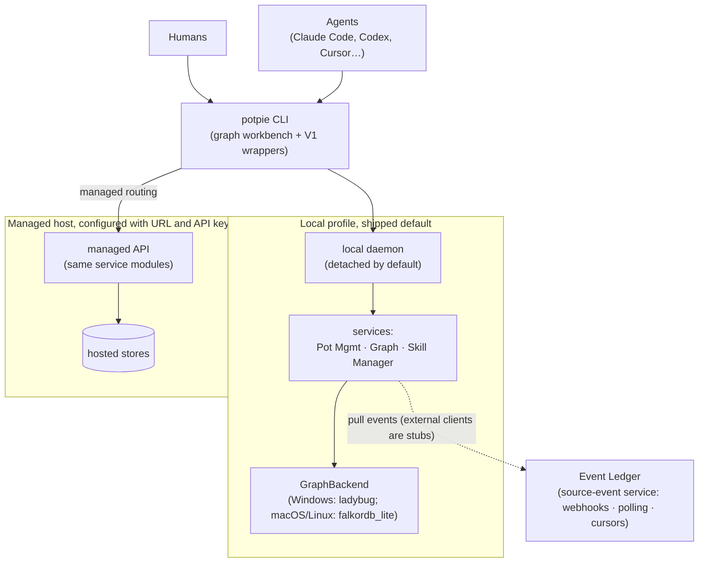

## Overview

The Context Graph stores sourced project facts for AI agents, including decisions,
ownership, infrastructure topology, bugs, fixes, conventions, and features. Agents
can reuse those facts across tasks instead of reading the same code, PRs, tickets,
and chats each time. Humans and agents use the same `potpie` CLI.

The `potpie graph …` workbench ships with data-plane contract `v1.5` and ontology
`2026-06-graph`. The legacy `resolve`, `search`, and `record` commands wrap the
same services. Pot Management, Graph, and Skill Manager service modules run in a
local daemon or a managed backend API. State stays local by default.



## Target OSS default

Install the published package from PyPI:

```bash
uv tool install potpie   # recommended
# or: pip install potpie
potpie setup        # provisions config, local stores, the default pot, the daemon, and skills
potpie status
```

The base package is the complete local product (CLI, daemon, local graph
backend). Semantic search with sentence-transformers is the optional
`embeddings` extra (`uv tool install 'potpie[embeddings]'`); without it, setup
falls back to the bundled hashing embedder.

For development in this checkout, use `make cli-install`. It builds the
graph-explorer UI, stops any old daemon, and installs the editable CLI. Do not use
raw `uv tool install --editable ./potpie/context-engine` for day-to-day reinstalls.

```bash
make cli-install
make cli-status     # confirm PATH / uv-tool install
potpie setup
potpie status
```

`setup` also registers your repo as a source. The agent ingests working-tree
context into the graph when needed. The OSS/CLI default backend is `falkordb_lite`,
an embedded FalkorDB over a local file. It requires no Docker, server, Neo4j, or cloud
key; override it with `--backend` or `CONTEXT_ENGINE_BACKEND`
(precedence: `CONTEXT_ENGINE_BACKEND` > legacy `GRAPH_DB_BACKEND` >
the platform default). Full flags live in [`cli-flow.md`](./cli-flow.md).

Windows installs Ladybug through the normal `pip install potpie` dependency set.
Use x64 Python 3.12–3.14 and the Microsoft Visual C++ Redistributable. Potpie
loads CPython's OpenSSL 3 libraries when the Ladybug wheel needs them, including
when native loading fails during the initial package import. A missing package
and a native DLL load failure report different installation guidance. The daemon
host mode remains the default; `CONTEXT_ENGINE_HOST_MODE=in_process` is also
supported. See [Ladybug storage and scope](./architecture.md#ladybug-storage-and-scope).

Configure a managed host with `potpie host set`, then use `potpie host use managed`
or pass `--host managed` to a command. Managed hosts support graph operations, pot
and source management, grants, and status. See the [CLI reference](../reference/cli.md#managed-hosts).

> Cloud login, status, push, pull, and skill sync commands remain stubs. External
> Event Ledger rebinding is also unimplemented. `ledger use` saves a binding but
> does not activate it. See [`ingestion-nudge.md`](./ingestion-nudge.md) for the
> internal Postgres event store.

## Start here

| Doc | What it answers |
|---|---|
| [`vision.md`](./vision.md) | Product goals, sourced claims, agent-owned reasoning, pots, and local, managed, and Event Ledger boundaries. |
| [`architecture.md`](./architecture.md) | Layers, runtime composition, daemon, backend capabilities, pot scoping, resource storage, and backend selection. |
| [`ontology.md`](./ontology.md) | Entity types, predicates, record types, contract versions, truth classes, mutation operations, source authorities, subgraphs, views, and identity keys. |
| [`querying.md`](./querying.md) | Graph reads, compatibility commands, the read orchestrator and readers, ranked evidence, filtering, and traversal. |
| [`writing.md`](./writing.md) | Semantic mutations, validation, runtime risk, proposals, commits, concurrency, receipts, inbox, and quality. |
| [`ingestion-nudge.md`](./ingestion-nudge.md) | Event admission, internal event storage, external Event Ledger clients, connectors, batching, and ingestion nudges. |
| [`skills.md`](./skills.md) | Bundled CLI skills, agent responses to nudges, and separate server-side reconciliation skills. |
| [`cli-flow.md`](./cli-flow.md) | Commands, flags, exit codes, snapshots, and the CLI workflow. |
| [`bench-plan.md`](./bench-plan.md) | Graph quality validation across backends, the invariant judge, and `run-light`. |

## Vocabulary

| Term | Meaning |
|---|---|
| Pot | Isolation boundary for queries, sources, inbox items, claims, mutations, and graph operations. The pot ID is the storage `group_id`. The active pot determines local or managed routing. Cross-pot federation is out of scope. |
| Daemon | Local background process in `potpie/daemon/lifecycle.py` that handles lifecycle, IPC, health, and logs. It runs detached by default and serves the read-only `potpie ui` explorer. |
| Services | Root capability services own pots, sources, setup, skills, and local identity. Graph Service owns graph reads, semantic mutations, and the workbench. Runtime composition assembles them for the local daemon. |
| GraphBackend | Backend with six ports. `mutation` and `claim_query` hold authoritative state. `semantic`, `inspection`, `analytics`, and `snapshot` provide rebuildable projections. `capabilities()` and `provision()` describe and prepare the backend. The default profile is `falkordb_lite`. |
| Skill Manager | CLI skill catalog and installer for agent harnesses. Skills teach agents to use the CLI. |
| Event Ledger | Separate source-event service for webhooks, polling, and replay cursors. Graph consumers pull events and track their own cursors and apply state. External clients are planned stubs. |
| Claim | Sourced fact with a truth class used by the ranker. The graph stores claims and source references. Full payloads such as diffs, document bodies, and transcripts live elsewhere. |
| Retrieval card | Text used to embed and search a claim, led by the agent-authored `description`. Write and read paths share one builder. |

The active package lives under
[`potpie/context-engine/`](https://github.com/potpie-ai/potpie/tree/main/potpie/context-engine). Use these docs in preference to older notes about the package.
