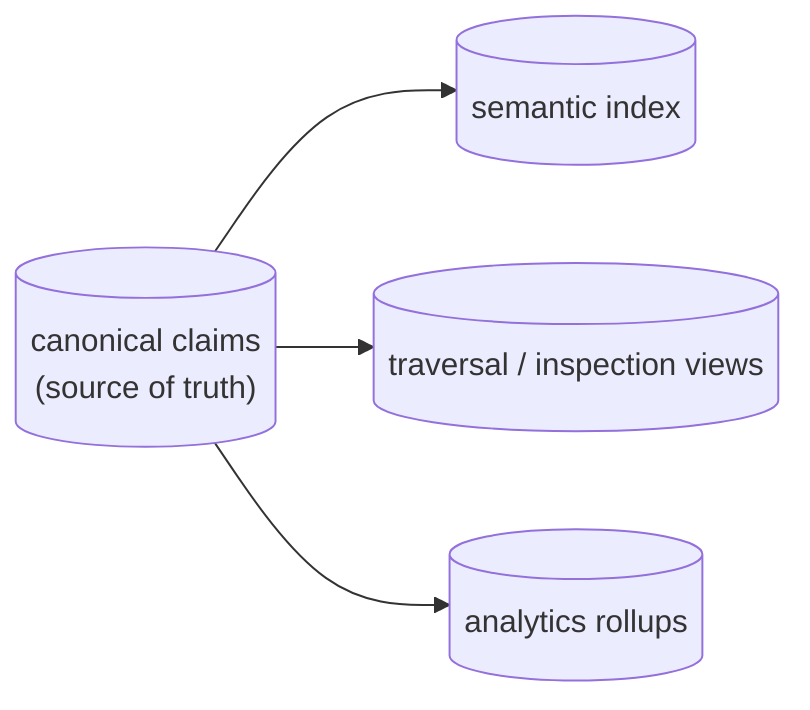
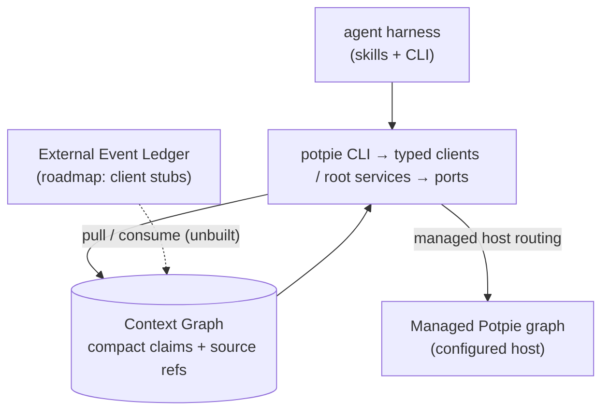

## Overview

The Context Graph stores sourced project facts for AI agents, including decisions,
ownership, topology, bugs, fixes, conventions, and features. Agents can reuse the
facts across tasks instead of reading the same source material each time.

This page explains the product goals and boundaries. Other pages cover
[architecture](./architecture.md), [ontology](./ontology.md),
[reading](./querying.md), [writing](./writing.md), [ingestion and nudges](./ingestion-nudge.md),
and [skills](./skills.md).

## The problem

Project context is scattered:

- decisions live in PRs, ADRs, Slack threads, and tickets;
- ownership and topology live in repo files, dashboards, and tribal memory;
- prior bugs and fixes are hard to retrieve by symptom;
- agents start each task with no durable memory of what previous agents learned.

Potpie should hold that context once, keep it fresh, and expose it through one
CLI that both humans and agents use.

## Claims, not payloads

The graph stores **compact claims plus source references, never the payloads
themselves**. It deliberately does *not* hold full PR diffs, document bodies, chat
transcripts, logs, webhook archives, or telemetry. A *claim* is a sourced,
time-stamped fact about an entity or a relationship; a *source ref* points back to
the evidence (a file path, PR, ticket, doc URL, deploy).

The canonical claim store holds authoritative state. Semantic search indexes,
traversal and inspection views, and analytics rollups are rebuildable projections
of those claims. Storage adapters implement the same graph model.



The entity types, public predicates, `RELATED_TO` fallback, and truth classes are
defined in [ontology.md](./ontology.md). PRs, commits,
issues, incidents, and deployments all collapse to a single timeline `Activity`
entity; an entity exists only if an edge needs it as an endpoint.

## One CLI surface for humans and agents

Humans and agents use the same `potpie` CLI. Engine operations route through the same finite typed operation
catalog whether they run through `LocalEngineClient` or `DaemonEngineClient`;
root capability commands use explicit root-owned services.

Agents reach the system directly through the CLI, including the full **Graph
Surface Lite** (`potpie graph catalog/read/search-entities/propose/commit/…`).
Read mechanics live in [querying.md](./querying.md); write mechanics in
[writing.md](./writing.md); the full command reference in [cli-flow.md](./cli-flow.md).

## Harness-owned intelligence

The user's coding harness, such as Claude Code, Codex, Cursor, or OpenCode,
reads source material and authors graph facts. Potpie skills teach the agent to
use the CLI. Potpie validates and stores the resulting facts.

The runtime follows these boundaries:

- The nudge service is deterministic (`NudgeService`, wired by the root runtime
  composition; no model on this path).
- Retrieval ships a **bundled local embedder by default**, so semantic search needs
  no API key (disable with `CONTEXT_ENGINE_EMBEDDER=none`).
- A service-side reconciliation agent exists only as an optional extra on the HTTP
  ingestion-server path, and it is **off by default**
  (`reconciliation_flags.agent_planner_enabled()` returns `False`).
- Writes never bypass validation: an ambiguous request becomes an **inbox item or a
  low-authority observation** for a harness skill to process, never an unsafe
  canonical fact.

See [skills.md](./skills.md) for the skill catalog and the read/write loop the
skills teach.

## Product shape



The local graph, managed graph, and Event Ledger have separate responsibilities.

| Boundary | Status | Description |
|---|---|---|
| **Local OSS self-serve** | **Shipped (V1.5)** | Installed with the CLI. `potpie setup` provisions config, local stores, the active `default` pot, source registration, the daemon, and skills. State stays local by default. Default backend `falkordb_lite` (no Docker/Neo4j/cloud needed). |
| **Managed Potpie graph** | **Client routing available** | A managed backend API hosting the same engine-owned domain on hosted stores with hosted auth/collaboration. The graph model is identical; deployment-specific composition and clients provide the boundary. |
| **Event Ledger** | **Roadmap** | A separate managed-or-self-hostable source-event service (webhooks, polling, replay cursors) that local or managed graphs *pull* from; it is never the graph source of truth. |

> Configure managed routing with `potpie host set` and `potpie host use managed`.
> Graph commands, pot and source management, grants, and status use that host.
> Cloud login, status, push, pull, and skill sync remain stubs. `ledger use` saves
> an external Event Ledger binding without activating it. See
> [ingestion-nudge.md](./ingestion-nudge.md) for the internal Postgres event store.

Local and managed share **one graph model** ("no separate local and cloud graph
models"). The Event Ledger is adjacent infrastructure for source events, not a
second graph model.

## Pots as tenancy

A **Pot is the unit of isolation and tenancy** — every query, source, inbox item,
claim, semantic mutation, and graph operation is scoped to exactly one pot. The pot
id **is** the storage `group_id` stamped on every entity node and relationship edge
(`reset_pot` is a `MATCH (n {group_id:$gid}) DETACH DELETE n`). A pot can be local
or managed; the active pot determines routing. First local setup creates an active
local `default` pot. **Cross-pot federation is an explicit anti-goal.**

## Core model

| Concept | Meaning |
|---|---|
| **Pot** | Unit of isolation and tenancy; `pot_id` is the storage `group_id`. A pot lives in the local daemon or a managed backend; the same CLI addresses both. First local setup creates the active `default` pot. |
| **Entity** | A stable project object — e.g. a `Service`, `Feature`, `Decision`, `Dependency`, `Person`/`Team`, or a timeline `Activity` (PRs/commits/issues/incidents/deployments collapse here). One of 24 catalog types; minted only when an edge needs it as an endpoint. |
| **Claim** | A canonical, sourced, time-stamped fact about an entity or relationship, carrying a truth class and provenance. The single source of truth. |
| **Source ref** | A pointer back to evidence: file path, PR, ticket, doc URL, or deploy. The graph holds the ref, not the payload. |
| **Semantic mutation** | An agent-facing structured write proposal (flat ops over a small DSL) that validates and lowers into graph writes. |
| **Inbox item** | Pending graph work captured when the agent or user is not yet ready to commit an ontology update; never a fact until processed. |
| **Event** | A source-system change (merged PR, ticket update, deploy). Raw events land in an internal event store and are turned into claims by ingestion — they are not stored verbatim. |

## What's shipped now (V1.5)

The `potpie graph …` workbench ships as V1.5. `main.py` registers the workbench
and the legacy `resolve`, `search`, and `record` commands.

Concretely, the live contract constants are:

| Constant | Value | Meaning |
|---|---|---|
| `GRAPH_CONTRACT_VERSION` | `v1.5` | the data plane (what's shipped) |
| `ONTOLOGY_VERSION` | `2026-06-graph` | the catalog/vocabulary version |
| `GRAPH_WORKBENCH_CONTRACT_VERSION` | `v2` | **only** the workbench *envelope* version string — not a separate, unshipped product |

The `v2` string identifies the workbench response envelope. Available operations include:

- **Reads:** `potpie resolve/search` and `potpie graph catalog/read/search-entities/
  neighborhood/history` over the single read trunk; reads return ranked evidence
  (an `AgentEnvelope`) — **there is no server-side answer synthesis**, the agent
  reasons over the evidence ([querying.md](./querying.md)).
- **Writes:** the canonical write door is **`graph propose` → `graph commit
  --verify`**. `graph mutate` is a **legacy wrapper** that internally calls
  propose+commit; `potpie record` remains the compatibility write path
  ([writing.md](./writing.md)).
- **Defaults:** `ladybug` on Windows and `falkordb_lite` on macOS/Linux, a detached `daemon` host mode, the
  bundled local embedder, installed skills, and the zero-token `graph nudge` a
  harness can call from its own hooks — all
  with no mandatory Docker, Neo4j, Postgres, or cloud service.

Run setup to register the repo as a source. The agent then ingests project
context into the graph:

```bash
potpie setup --repo . --agent claude
potpie status
```

After setup, an agent discovers the contract (`graph catalog`), reads bounded views
(`graph read`), resolves identity (`graph search-entities`), and saves project
facts (`graph propose` → `graph commit --verify`). See
[cli-flow.md](./cli-flow.md) for the full command reference.

## Anti-goals

- No separate local and cloud graph models.
- No second long-term agent surface beyond the workbench.
- No write path that bypasses semantic validation and commit.
- No Potpie-owned LLM/reconciliation agent as the canonical source of graph
  intelligence.
- No source-provider credentials in the local daemon by default.
- No full source payloads in the graph.
- No Event Ledger as the graph source of truth.
- No hidden cloud dependency for local use.
- No mandatory Docker, Neo4j, Postgres, or cloud embedding service for OSS.
- No business logic in the daemon lifecycle layer.
- No cross-pot federation in this design.

## See also

- [architecture.md](./architecture.md) — hexagonal layers, composition roots, the daemon, backends.
- [ontology.md](./ontology.md) — the 24 entities / 26 predicate keys / truth classes / contract constants.
- [querying.md](./querying.md) — the two read altitudes, the read trunk, ranking, retrieval cards.
- [writing.md](./writing.md) — the semantic DSL, propose→commit, the legacy `mutate` wrapper, inbox.
- [ingestion-nudge.md](./ingestion-nudge.md) — how raw events arrive, the two ledgers, the nudge model.
- [skills.md](./skills.md) — harness-owned intelligence and the skill read/write loop.
- [cli-flow.md](./cli-flow.md) — the full `potpie` command reference.
